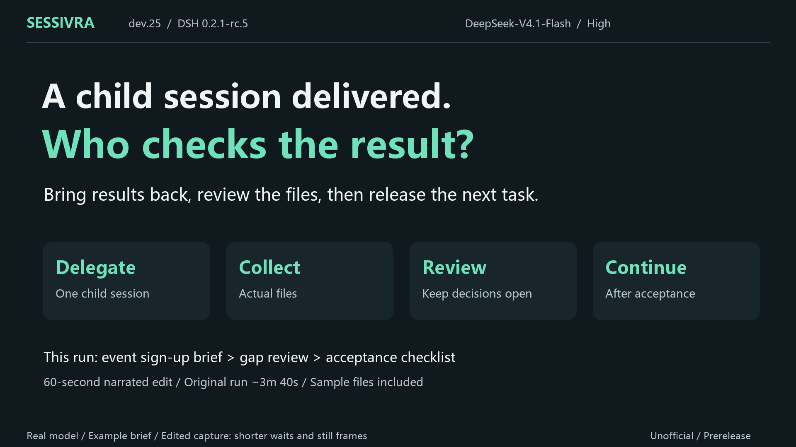

# DSH Sessivra

[中文](README.md) · **English**

**Bring a child session's work back to the main chat, review the actual files, and then release the next task.**

Sessivra is an unofficial task-coordination plugin for [DeepSeek Harness (DSH)](https://github.com/deepseek-ai/deepseek-harness). The main session delegates work to ordinary child sessions and receives their questions and results. Follow-up tasks for the same execution session stay queued until the current task is explicitly accepted. Child sessions remain independently accessible.

**Prerelease: `0.3.0-dev.26`. Requires DSH `0.2.1-rc.5`, Node.js 24+, and sessions in the same Host/profile.** Independently developed and maintained by community members; no official endorsement.

**New in dev.26: free split views.** Drag sessions to any pane edge to split, resize dividers, and use compact single-row headers with Chat/Trajectory menus and × close controls. Visible sessions are highlighted in the sidebar; dropping into a composer inserts a native session reference. [Usage and validation scope](docs/SESSION_VIEWS.md).

[](https://github.com/leoan698-tom/dsh-sessivra/releases/download/v0.3.0-dev.25/Sessivra-dev25-real-task-demo-en.mp4)

[Watch/download the English demo](https://github.com/leoan698-tom/dsh-sessivra/releases/download/v0.3.0-dev.25/Sessivra-dev25-real-task-demo-en.mp4) · [Demo evidence and limitations](docs/DEMO_DEV25.md) · [Report a problem](https://github.com/leoan698-tom/dsh-sessivra/issues)

The demo uses a real model and an example brief. It contains edited capture, shortened waits, still frames, and AI narration; the recorded UI and generated files are in Chinese. It shows one completed scenario, not an independent user trial or a reliability benchmark. One output-limit recovery and five rejected tool calls occurred during the run.

## Quick start

In DSH, open **Plugins → Add plugin**, select the official npm source, and enter only:

```text
dsh-plugin-sessivra@0.3.0-dev.26
```

Follow the restart/reload prompt and confirm the installed version is `0.3.0-dev.26` and the plugin is enabled. The package contains compiled files; no build is needed.

Alternatively, exit the DSH instance using your target profile and run this in a terminal:

```sh
dsh plugin --profile desktop add dsh-plugin-sessivra@0.3.0-dev.26
```

Use `--profile web` for Web, or the exact profile and `DSH_HOME` used by your instance. Do not paste the full terminal command into the package-name field. Pinning the version avoids ambiguity during the host's package-release-age protection window.

If you previously installed the scoped Sessivra package, Agent Hub, or the old messenger package, follow the [migration instructions](docs/RENAMING.md) before enabling this package. They must not run together. [Release and offline package](https://github.com/leoan698-tom/dsh-sessivra/releases/tag/v0.3.0-dev.26).

## Try one small task

After installation, create an empty working folder and save this example as `requirements.md`:

```text
Signed-in residents can register for community events using their name
and contact phone number. Each event has a capacity and a registration
deadline. Successful registrations are saved. Residents can view their
registrations and cancel before an event starts. Administrators can view
the registration list. Error handling, duplicate actions and capacity
changes are not yet defined. Review this brief only; do not implement
pages or connect to a real system.
```

Open that folder in DSH and send this request to the main chat:

```text
Use Sessivra to create an ordinary child session to review requirements.md.
Ask it to write review.md citing the source, missing rules, suggestions,
and verifiable acceptance conditions. Keep undefined business rules marked
as pending human confirmation.

Queue a second task for the same child session: turn the review into a draft
acceptance-checklist.md. Keep it queued until the first task is accepted.
Read and check the actual files in this main session. Ask me before formally
accepting the first task and releasing the follow-up.
```

Use this example to learn the flow, then try a small brief of your own.
Inspect the returned review. If it meets your criteria, confirm acceptance in the main chat and check that the follow-up starts afterwards. Judge the usefulness of the files yourself; delivery status or a model's completion claim does not establish correctness.

We are looking for **five DSH users** to try one small task of their own. If you try it, [reply in the project discussion](https://github.com/deepseek-ai/deepseek-harness/discussions/11837) with where you got stuck, whether the result was useful, and whether you would use it again. Chinese and English feedback are welcome. No private project files or full chat logs are needed.

## Other capabilities and limits

- Native `@` session references, explicit task/message sending, and replies linked to the original request. A reference alone does not dispatch work.
- Shared business questions within a matching coordination scope, topic, conditions, and options. Tool permission approvals remain with DSH.
- Updated requirements adopted at a safe boundary after the current tool finishes; running tools are not forcibly killed.
- A session tree for ordinary child sessions and team members, plus rename, pin, archive, local aliases, and search.
- Same Host/profile only; no cross-machine or cross-process messaging. Internal rc.5 interfaces are dependencies, so other host versions need separate verification.
- Business review still depends on the coordinating model and human judgment. Queue and acceptance records cannot guarantee artifact quality.

The public release passed 49 unit/client tests and 81 integration tests. The separate demo passed 19 run-evidence checks. These denominators describe specific checks, not general model reliability.

[Managed tasks and recovery](docs/MANAGED_TASKS.md) · [Release verification](docs/validation/dev26-release.md) · [Known issues](docs/KNOWN_ISSUES.md) · [Install/uninstall](docs/OPERATIONS.md) · [MIT License](LICENSE)
