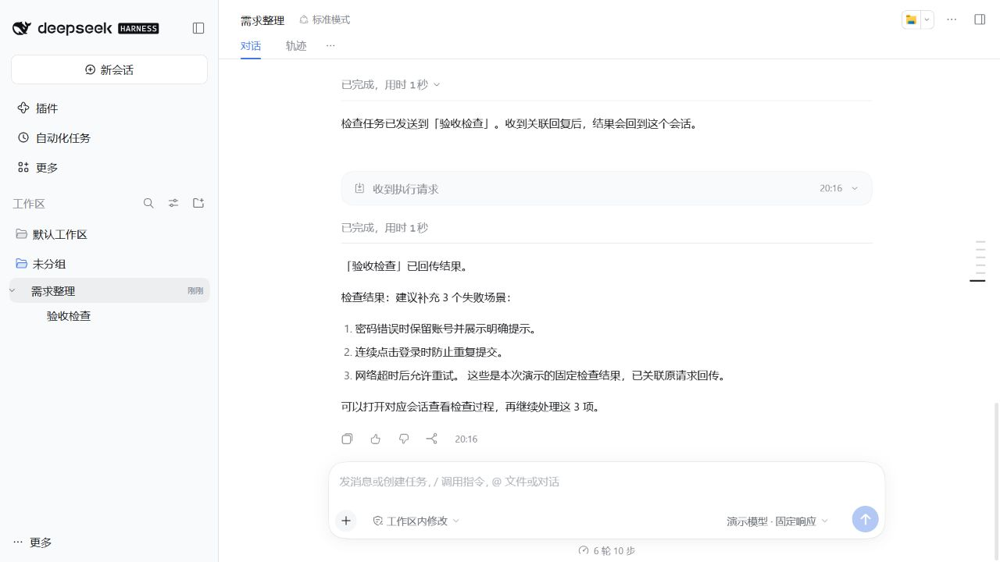
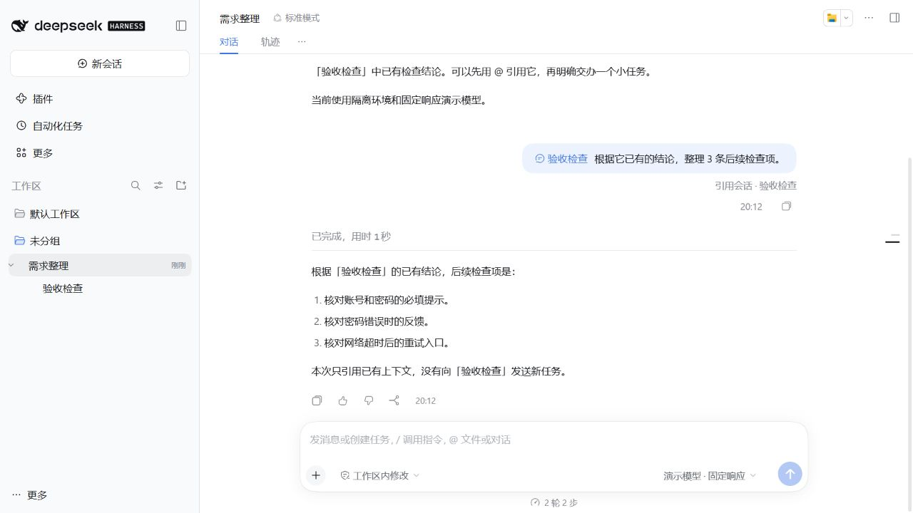
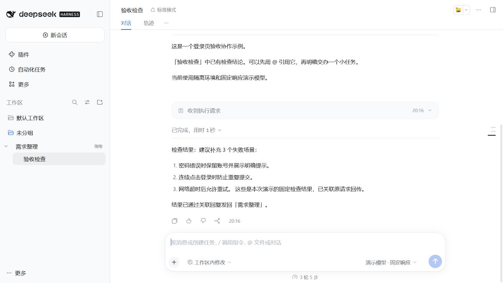

# DSH Sessivra

**让 DSH 会话协作完成任务：发消息、同步进展、共享问题与裁决，检查结果后再放行后续工作。**

Sessivra 是 DSH 的会话通信与任务协作插件。用原生 `@会话` 选择已有对象，或让主会话创建普通子会话，再用自然语言交代目标和验收条件。会话保持独立，消息、任务版本、共同决定和结果可以关联回主会话。

**dev.25 新增受管任务协作，并包含侧栏改进及 dev.24.local.2 的全部修复。**同一执行会话的后续任务会排队，前一项须由协调会话检查产物并显式验收；需求调整在当前工具结束后的安全边界采用。支持上下文引用、关联回复和会话树，限同一 Host、同一 profile。

> 当前版本安装输入：`dsh-plugin-sessivra@0.3.0-dev.25`。在 DSH「插件 → 添加插件」中只填这个包版本；终端命令见下方，桌面使用 `desktop`，Web 使用 `web`。

[开始使用](#开始使用) · [使用示例](#使用示例) · [安装与卸载](docs/OPERATIONS.md) · [已知问题](docs/KNOWN_ISSUES.md) · [反馈问题](https://github.com/leoan698-tom/dsh-sessivra/issues)

非官方项目，由社区成员独立开发和维护。兼容 **DSH 0.2.1-rc.5 / Node.js 24+**。

## 把主子会话的工作连接起来

| 你遇到的问题 | Sessivra 的处理方式 |
| --- | --- |
| 主会话改了要求，子会话仍按旧要求做 | 保存当前版本和已采用版本，侧栏显示待同步；在安全步骤采用新版本 |
| 多个子会话重复询问同一个业务选择 | 在相同协作范围、主题、条件和选项下共享问题；回答一次后自动传回相关任务 |
| 需要手工复制提示词和结果 | 自动派发任务、通知问题与阻塞、传回裁决和结果 |
| 新工作打断当前任务或提前开始 | 同一会话排队；等待裁决、暂停及待验收期间仍保留当前任务位置 |
| 子会话说完成了，却没有检查产物 | 结果先进入待验收，协调会话检查实际产物并记录证据后才完成任务 |

可以在主会话中这样开始：

```text
创建建设 B 和复核 C 两个普通子会话。B 实现登录页，C 在建设完成后检查验收条件。
由你协调任务、进度、共同问题和结果，问题集中在这里问我，完成后检查实际产物再验收。
```

后续要求可以说：“现在为同一个 B 登记补充测试说明的任务，先排队，等当前任务完成并验收后再执行。”

插件保存和传递状态，业务检查仍由协调会话完成。问题去重需要登记准确范围和条件，原生工具审批仍由宿主管理。[任务协作、恢复与回退](docs/MANAGED_TASKS.md) · [发布验证](docs/validation/dev25-release.md)

## 会话通信、上下文引用与会话树

| 你想做什么 | 在 DSH 中怎样操作 |
| --- | --- |
| 会话之间发消息 | 从当前普通会话向另一个普通会话发送任务、问题或结论，普通子会话也保留独立通信能力 |
| 把结果回复到原会话 | 接收方显式回复时，结果关联到原请求并送回来源会话 |
| 对方忙时排队发送 | 默认等待目标当前执行结束，再按顺序发送消息 |
| 及时补充或调整正在执行的任务 | 明确要求即时调整时，可直接插入消息，在目标的下一执行步接收；不取消正在运行的工具 |
| 引用另一个会话的上下文 | 用原生 `@` 引入有界历史上下文，让当前会话参考其结论；单纯引用不会发送消息或唤醒对方 |
| 找到主会话与分出去的工作 | 在原生工作区列表中展开会话树，打开普通子会话和团队队员；其他子智能体不在侧栏展示 |

工作区标题栏、搜索和工作区操作沿用宿主。侧栏保留普通会话、普通子会话和团队队员，支持子会话改名、置顶、归档、成员本地别名和搜索定位。

例如，A「需求整理」向 B「验收检查」发送检查要求，B 处理后把结果关联回复给 A，A 再根据结果继续工作。主会话也可以向自己直接拥有且可继续的子智能体派发任务；具体对象限制见下方使用范围。



上图为 DSH rc.5 / Sessivra dev.19 改名候选的实际 Web 界面，使用独立演示会话和固定响应模型；展示插件传输与界面，不代表真实模型业务验收。

[观看 63 秒字幕演示（MP4）](https://raw.githubusercontent.com/leoan698-tom/dsh-sessivra/main/docs/media/sessivra-demo-zh.mp4)：引用已有结论 → 明确派发任务 → 关联回复 → 打开对应子会话。录制环境与上图相同。

<details>
<summary>查看上下文引用与会话树截图</summary>





</details>

## 开始使用

**当前版本为 `0.3.0-dev.25`（预发布）**，npm 包名为 **`dsh-plugin-sessivra`**，显示名称为 **DSH Sessivra 协作空间**。兼容 DSH `0.2.1-rc.5` / Node.js 24+。

### 在 DSH「添加插件」窗口安装

打开「插件 → 添加插件」，选择 npm 官方源，输入框只填写：

```text
dsh-plugin-sessivra@0.3.0-dev.25
```

DSH rc.5 自带 pnpm 的默认发布时间保护为 24 小时。新版本发布首日，仅填裸包名可能仍安装 dev.20；使用上面的固定版本可明确选择 dev.25，安装后核对版本。无需关闭全局保护。

点击「安装」，完成后按界面提示重启或重新加载，确认版本为 `0.3.0-dev.25` 且插件已启用。这里只填写包名，不加引号，不粘贴终端命令。

已安装 `@leoan698-tom/dsh-sessivra`（dev.19）、原信使包或 Agent Hub dev.18 的用户，先按[改名与迁移](docs/RENAMING.md)移除对应旧包，再安装新包。它们使用同一组服务和持久数据，不能同时启用。

### 在终端安装

以下完整命令在 PowerShell、CMD 或其他终端中执行：

1. 确认 DSH 已完成首次启动，CLI 版本为 `0.2.1-rc.5`。
2. 正常退出使用目标 profile 的 DSH，然后安装：

```sh
dsh --version
dsh plugin --profile desktop add dsh-plugin-sessivra
```

3. 重启 DSH，在插件列表确认启用，然后在输入框键入 `@` 选择一个已有会话。

Windows 桌面版未配置 PATH 时，使用安装目录内的 CLI，将下面的路径换成实际位置：

```powershell
& 'D:\DeepSeekHarness\resources\runtime\cli\bin\dsh.cmd' plugin --profile desktop add dsh-plugin-sessivra
```

需要固定版本时使用 `dsh-plugin-sessivra@0.3.0-dev.25`。Web 用户将 `desktop` 换成 `web`；自定义 profile 和 `DSH_HOME` 应与实际宿主一致。安装包包含编译产物，使用者无需构建。

[npm 包页面](https://www.npmjs.com/package/dsh-plugin-sessivra) · [GitHub Release 与离线安装包](https://github.com/leoan698-tom/dsh-sessivra/releases/tag/v0.3.0-dev.25) · [升级与回退](docs/RENAMING.md)

## 使用示例

先准备两个普通会话，例如“需求整理”和“验收检查”。在当前会话的输入框中，通过原生 `@` 菜单选中对方，再输入通信要求。

**发送任务并接收回复：**

```text
@验收检查 请检查这份方案中的遗漏项，完成后回复我。
```

当前会话向「验收检查」发送请求。接收方生成结果并显式回复时，结果关联原请求，回到当前会话。

**向另一个会话提问：**

```text
@验收检查 帮我问它：登录页还有哪些失败场景没有覆盖？请把答复发回这里。
```

**把当前结论发给另一个会话：**

```text
@验收检查 把我们刚确认的这 3 条需求发给它，作为下一轮检查依据。
```

**补充正在执行的任务：**

```text
@验收检查 现在告诉它：这次也要检查网络超时后的重试，不用等当前任务做完。
```

**引用已有结论作为上下文：**

```text
@验收检查 根据它已有的结论，整理 3 条后续检查项。
```

这一条只让当前会话获得有界历史上下文，「验收检查」不会因此运行新任务。

**同时参考多个会话，再指定收件人：**

```text
@需求整理 @验收检查 对比两边的结论，把待补充的检查事项发给验收检查。
```

两份上下文都可以使用，发送对象由当前要求明确指定。

**找到对应会话：** 在原生工作区列表中展开主会话。普通子会话可以独立打开和继续聊天；团队成员标为“队员”。侧栏隐藏其他子智能体的节点，保留其宿主身份、执行记录和生命周期。

AI 根据每条要求选择排队或直接插入。即时调整在下一执行步接收，不取消正在执行的工具；仅选择、引用或查询不会授权发送。

## 使用范围

- 同一 Host、同一 profile 内使用，不支持跨机器或跨进程通信。
- 宿主每条消息最多引用 3 个会话；历史快照可能截断。
- 一次性对象只读。其他主会话的子智能体可以在宿主允许时被引用，但只有自己直接拥有且可继续的子智能体才能接收派发任务。
- 消息送达或领取不代表业务完成；Team 任务板由团队工具维护。
- 不确定投递不会自动重发；历史引用元数据被宿主压缩移除后，需要重新 `@` 对象。
- 插件依赖 rc.5 内部父子通信接口，其他 DSH 版本需要单独验证。

当前版本为预发布，已知依赖风险见[已知问题](docs/KNOWN_ISSUES.md)。自动化、隔离真实模型和原生桌面验证分别记录在[测试报告](docs/TEST_REPORT.md)。已通过明确的 A/B/C 任务协作场景；单轮场景成功不代表任意业务或模型的可靠性统计。

## 开发与支持

```sh
git clone https://github.com/leoan698-tom/dsh-sessivra.git
cd dsh-sessivra
npm ci --ignore-scripts
npm run check
npm pack
```

`dist/` 随 Git 提交，源码变更后应重建并同步。默认测试使用真实 rc.5 运行时和免费确定性模型适配器，不调用付费模型。

反馈时请提供 DSH 版本、插件版本、操作系统、复现步骤、预期和实际结果；截图请先隐去私密信息。

[安装、升级和卸载](docs/OPERATIONS.md) · [功能说明](docs/COLLABORATION_0_3_DEV15.md) · [架构](docs/ARCHITECTURE.md) · [变更记录](CHANGELOG.md) · [第三方声明](THIRD_PARTY_NOTICES.md) · [MIT License](LICENSE)
